<div align="center">

# CampusMate AI

**An AI campus assistant that answers in English, Hindi and Hinglish, and shows the records behind every answer.**

Built as a B.Tech Information Technology project at U.V. Patel College of Engineering, Ganpat University.


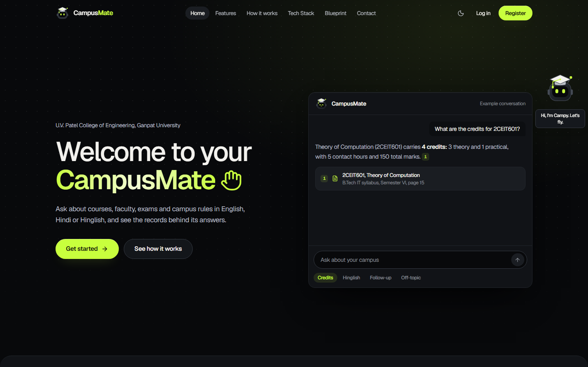

</div>

> [!IMPORTANT]
> CampusMate AI is an **academic prototype that runs locally**. Faculty, labs, rooms, policies, notices, calendar entries and FAQs are **sample data**, not official Ganpat University information. Do not deploy it publicly or use it with real student data before completing the [security work](#current-limitations).

## Contents

- [What it does](#what-it-does)
- [Screenshots](#screenshots)
- [Architecture](#architecture)
- [How an answer is produced](#how-an-answer-is-produced)
- [Hybrid RAG](#hybrid-rag)
- [n8n workflow](#n8n-workflow)
- [Tech stack](#tech-stack)
- [Getting started](#getting-started)
- [Project structure](#project-structure)
- [Data](#data)
- [Testing and results](#testing-and-results)
- [Current limitations](#current-limitations)
- [Roadmap](#roadmap)

## What it does

### For students

- **Ask in natural language** about courses, credits, faculty, labs, exams, notices and campus rules.
- **Check the source.** Answers carry numbered citations that open the record they came from.
- **Use your language.** English, Hindi and Hinglish questions are supported.
- **Ask follow-ups** such as "Who teaches it?" without repeating the subject.
- **Get study help** with revision plans, textbook suggestions and learning links.
- **Trust the limits.** The assistant asks when a question is ambiguous, refuses off-topic requests and says so when the records do not contain an answer.
- **Manage conversations** with search, pinning, renaming, Markdown export, copy and read-aloud.

### For administrators

- Invite-based admin onboarding and TOTP two-factor sign-in on the Admin Portal.
- User management with verification, password reset and account removal.
- Knowledge file uploads for the assistant.
- A read-only console for all 23 campus datasets, with global search and record provenance.

## Screenshots

| Cited campus answer | Source record |
|---|---|
| 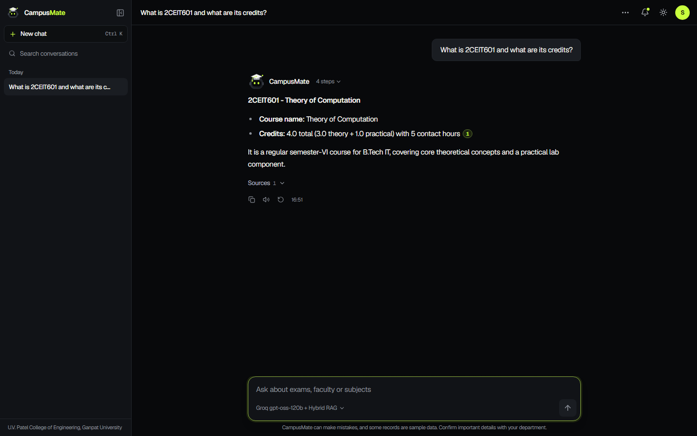 | 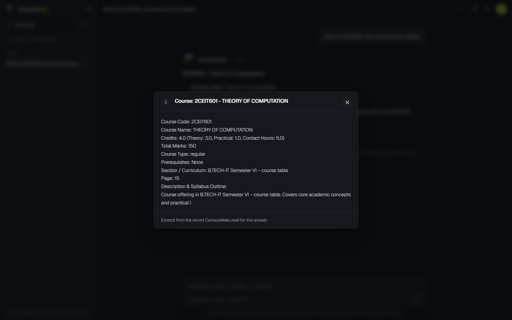 |

| Hinglish question | Study plan with learning links |
|---|---|
| 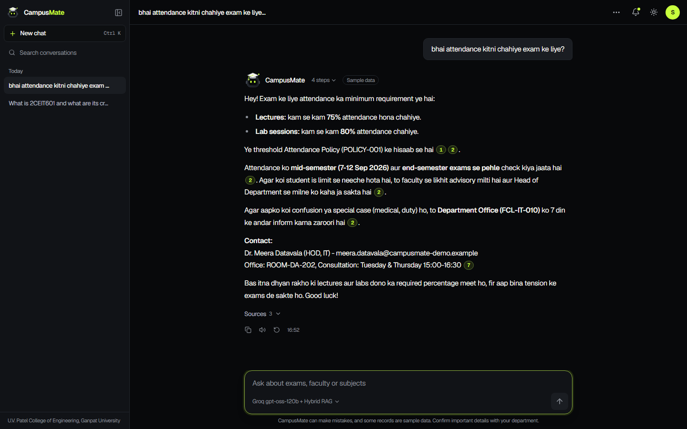 | 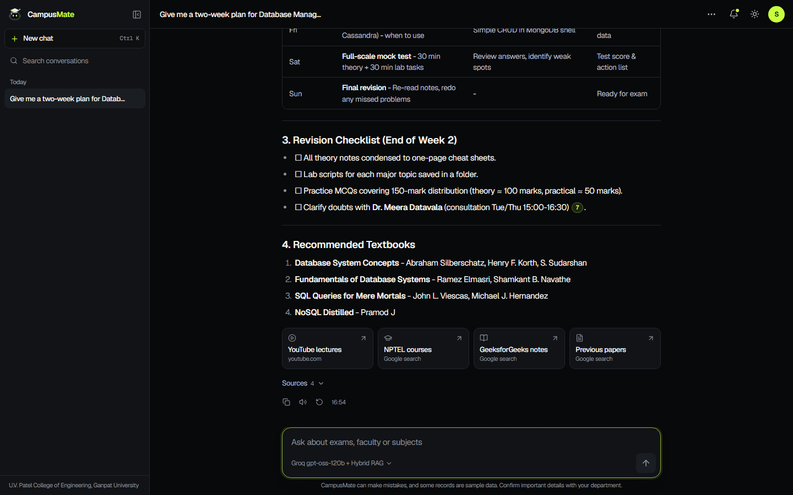 |

| Admin overview | Academic data browser |
|---|---|
| 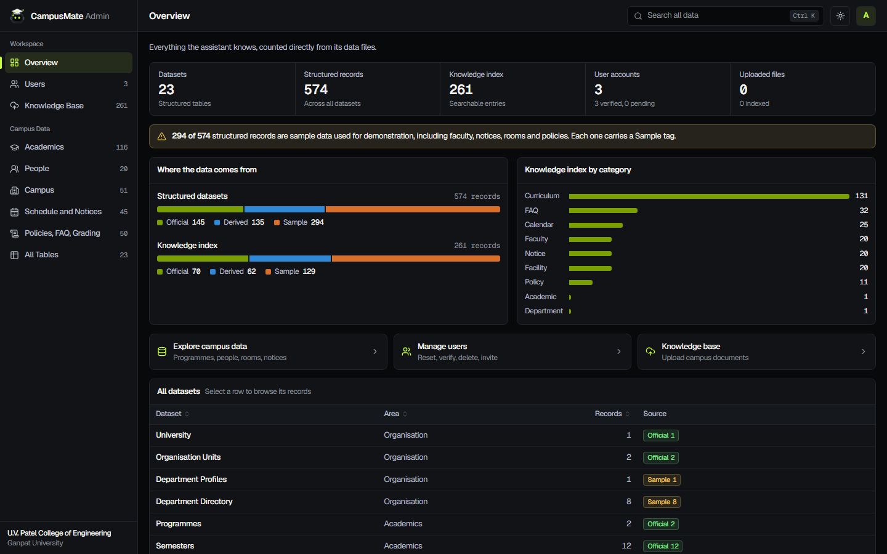 | 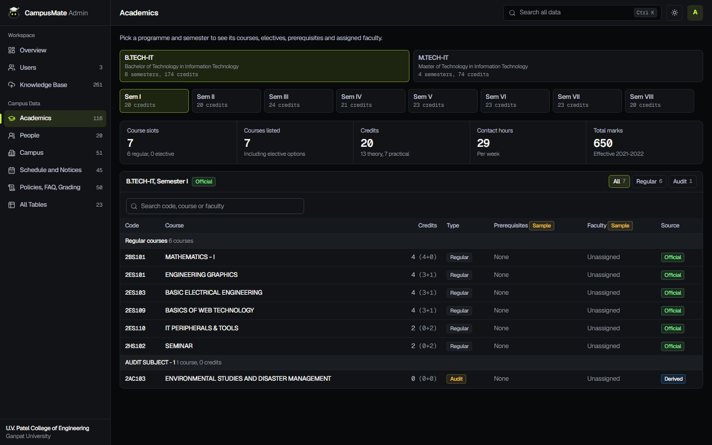 |

## Architecture

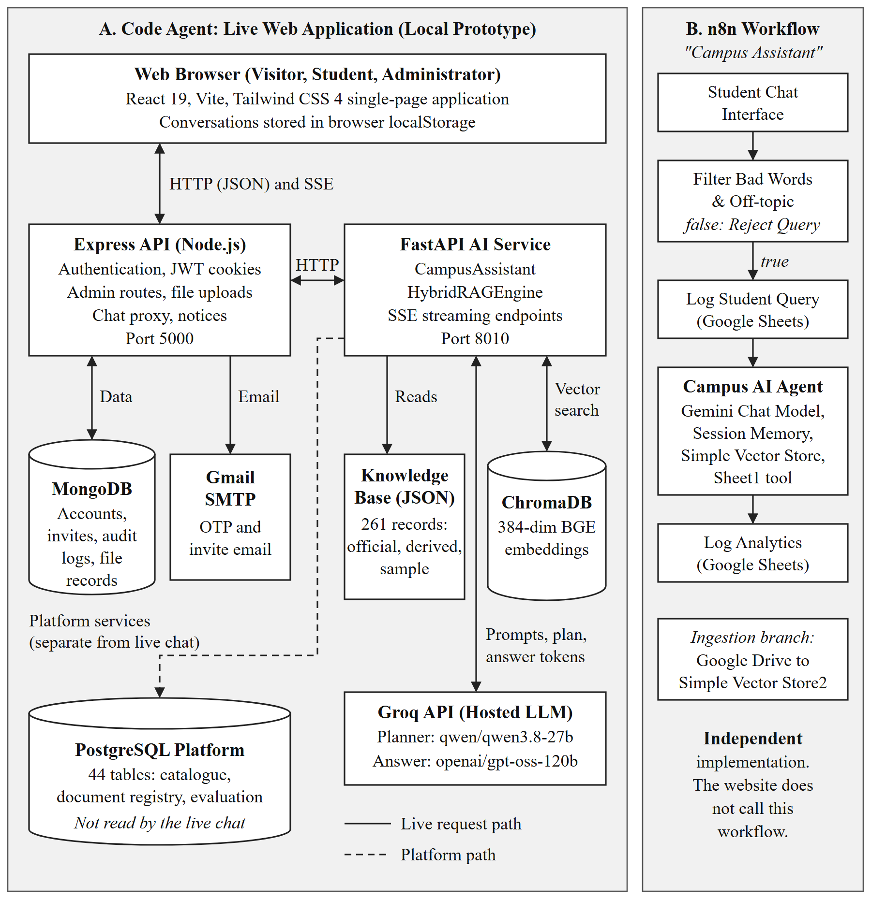

| Service | Port | Responsibility |
|---|---:|---|
| React + Vite client | `5173` | Landing page, authentication, chat workspace, admin console |
| Express API | `5000` | Accounts, admin APIs, uploads, email, chat proxy |
| FastAPI AI service | `8010` | Query planning, Hybrid RAG, answer generation, platform APIs |
| MongoDB | `27017` | Users, invites, audit logs, file records |
| PostgreSQL | `5432` | Platform schema, catalogue, document registry, evaluation |

## How an answer is produced

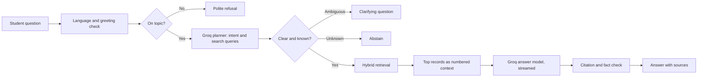

If Groq is unavailable, a local extractive engine answers from the same knowledge base.

## Hybrid RAG

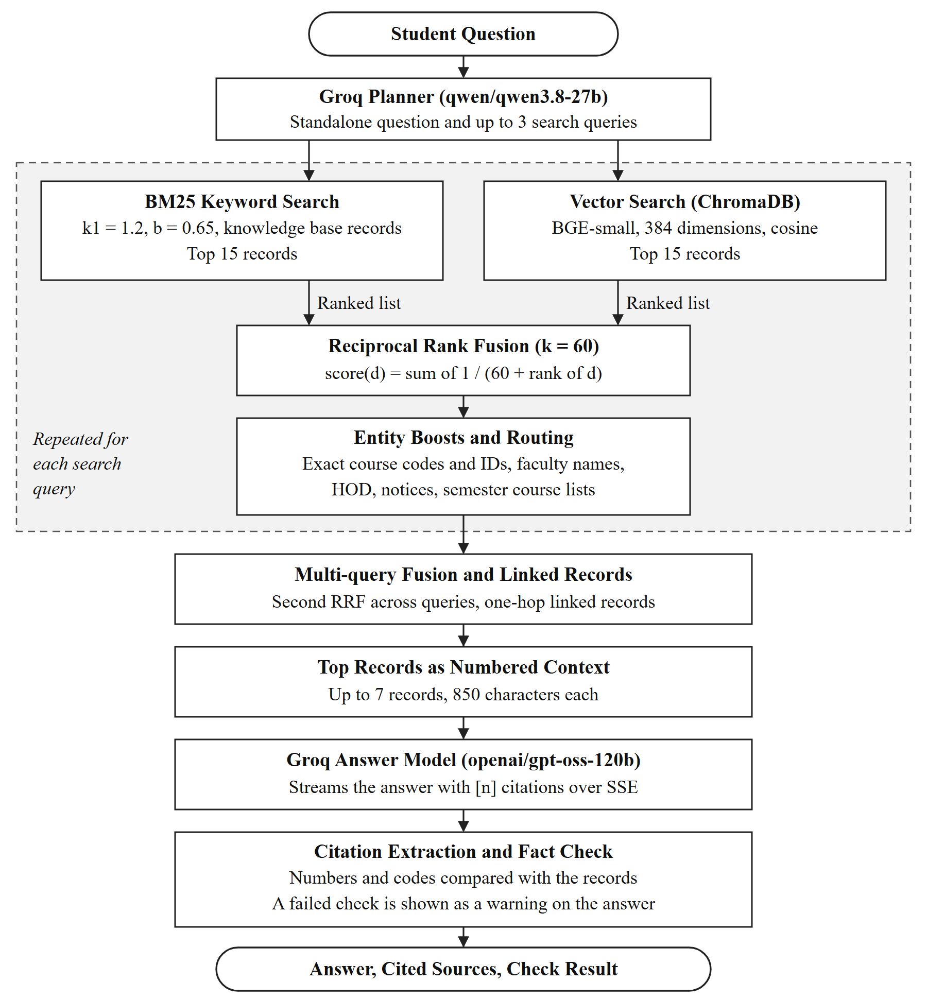

Keyword search is precise on exact identifiers such as `2CEIT601`, while semantic search understands meaning. CampusMate AI runs both and merges their rankings.

| Stage | Implementation |
|---|---|
| Keyword retrieval | BM25 with `k1 = 1.2`, `b = 0.65` |
| Embeddings | `BAAI/bge-small-en-v1.5`, 384 dimensions, ONNX on CPU |
| Vector store | Embedded ChromaDB with cosine similarity |
| Fusion | Reciprocal Rank Fusion with `k = 60` |
| Routing boosts | Exact course codes, entity IDs, faculty names, notices and semesters |
| Context | Up to 7 records, 850 characters each |
| Planner model | `qwen/qwen3.8-27b` on Groq |
| Answer model | `openai/gpt-oss-120b` on Groq |

## n8n workflow

The project also includes a **separate no-code implementation** built in n8n. It runs independently, and the website does not call it.

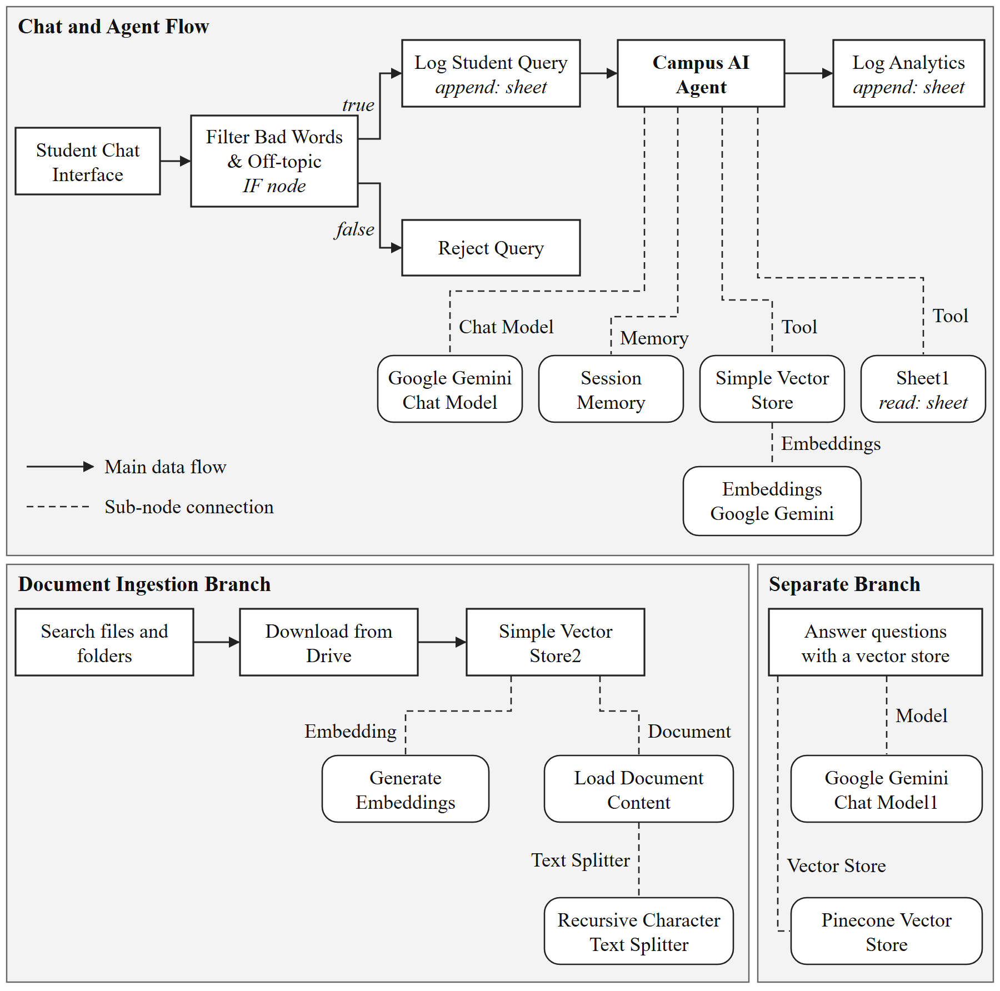

It filters a student's query, logs it to Google Sheets, and passes it to a Campus AI Agent that uses the Google Gemini chat model, session memory, a vector store with Gemini embeddings, and a Google Sheets tool. A separate branch loads documents from Google Drive, splits them and stores their embeddings.

## Tech stack

| Layer | Technologies |
|---|---|
| Frontend | React 19, Vite, Tailwind CSS 4, Framer Motion, Lucide |
| Application server | Node.js, Express, Mongoose, JWT, bcrypt, Speakeasy (TOTP), Multer, Nodemailer |
| AI service | Python, FastAPI, Pydantic, SQLAlchemy, Alembic |
| Retrieval | Custom BM25, FastEmbed, ChromaDB |
| Language models | Groq; optional OpenAI-compatible providers |
| Data | MongoDB, PostgreSQL, JSON knowledge base |
| Automation | n8n, Google Gemini, Google Drive, Google Sheets |
| Testing | pytest, Playwright-driven end-to-end checks |

## Getting started

### Prerequisites

- [Node.js](https://nodejs.org/) 20 or newer
- [Python](https://www.python.org/) 3.11 or newer
- A [Groq API key](https://console.groq.com/) for generated answers
- [MongoDB](https://www.mongodb.com/) to keep accounts between restarts. Without it, accounts live in memory only
- [PostgreSQL](https://www.postgresql.org/) only for the platform APIs, seeding and evaluation

### 1. Install

```bash
git clone https://github.com/DevenX4/CampusMate2.0.git
cd CampusMate2.0
npm install
pip install -e AI_workflow/backend
```

### 2. Configure

```bash
cp server/.env.example server/.env
cp AI_workflow/.env.example AI_workflow/backend/.env
```

Generate two different random values for `JWT_SECRET` and `JWT_REFRESH_SECRET` in `server/.env`:

```bash
node -e "console.log(require('crypto').randomBytes(48).toString('hex'))"
```

Add these to `AI_workflow/backend/.env`:

```env
DB_PASSWORD=your_database_password
GROQ_API_KEY=your_groq_api_key
```

### 3. Run

On Windows, double-click **`start.bat`**, or run:

```bash
npm run dev
```

Then open **http://localhost:5173**. Use `stop.bat` or `npm run stop` to stop every service.

On macOS or Linux, run each service in its own terminal:

```bash
npm run start-server
npm run start-ai
npx vite
```

## Project structure

```text
CampusMate2.0/
├── src/                    React client
│   └── components/         Landing, auth, chat, admin, brand
├── server/                 Express API
│   ├── routes/             auth, admin, chat, knowledge
│   ├── models/             Mongoose models with in-memory fallback
│   └── middleware/         JWT and admin guards
├── scripts/launch.mjs      Starts, monitors and stops all services
├── AI_workflow/
│   ├── backend/app/
│   │   ├── assistant/      Live Groq assistant
│   │   ├── retrieval/      Hybrid engine, BM25, vectors
│   │   ├── api/routes/     FastAPI endpoints
│   │   ├── chat/, routing/ PostgreSQL answer pipeline
│   │   ├── generation/     LLM providers
│   │   ├── ingestion/      Document pipeline
│   │   └── models/         Database schema
│   ├── data/               Structured campus datasets
│   ├── DataSource/         Source documents and audits
│   ├── storage/            Live knowledge base
│   └── evaluation/         Question sets and results
└── docs/                   Design notes, screenshots, diagrams
```

## Data

| Trust level | Meaning | Examples |
|---|---|---|
| `official` | From a Ganpat University PDF | Course codes, credits, marks, semesters, grade bands |
| `derived_official` | Restructured from an official PDF | Course and offering records |
| `synthetic` | **Sample data created for development** | Faculty, labs, policies, notices, calendar, FAQs |

The live knowledge base has **261 records**: 70 official, 62 derived and 129 sample. The answer interface marks sample sources.

## Testing and results

Measured on 22 November 2026 on a local machine.

| Check | Result |
|---|---|
| End-to-end checks across functional, integration, system, acceptance, performance and security scenarios | **79 of 79 passed** |
| Backend pytest suite | **301 of 306 passed, 5 open failures** |
| Expected record found in retrieved context, 52 campus questions | **90.4%** |
| Off-topic questions refused, 20 scripted questions | **100%** |
| Median record search time | **49 ms** |

The retrieval figures measure whether the correct record was found. They do not measure the factual accuracy of generated answers, which has not yet been formally evaluated.

```bash
cd AI_workflow/backend
python -m pytest -q
```

## Current limitations

This prototype is intended for local demonstration. Before any public or real-data use:

- Restrict self-registration so that it cannot create administrator accounts.
- Require two-factor verification on every administrator sign-in path.
- Add authentication and rate limits to the chat and ingestion APIs.
- Remove demo accounts and development sign-in shortcuts.
- Replace sample records with verified university data.
- Show or block answers that fail the fact check more strictly.
- Scope locally saved chat history to each user.

## Roadmap

- Server-side chat history and answer feedback
- Formal evaluation of answer accuracy
- Teacher module and more departments
- OCR and non-PDF document ingestion
- Production deployment
- Integration of the n8n workflow with the web application
